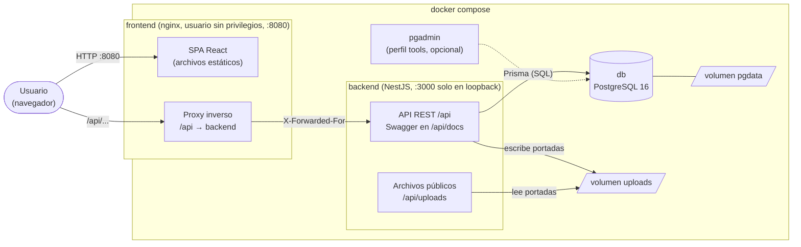
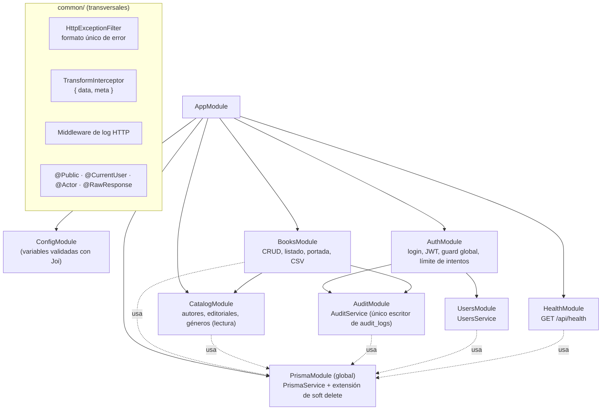
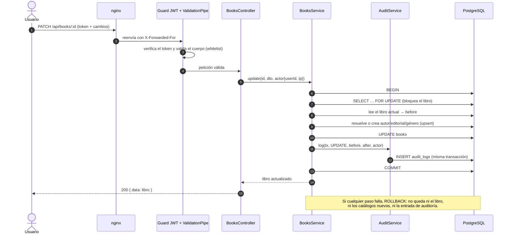
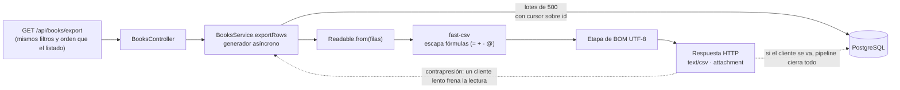
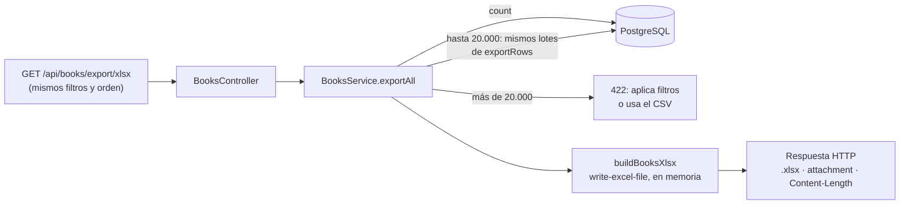
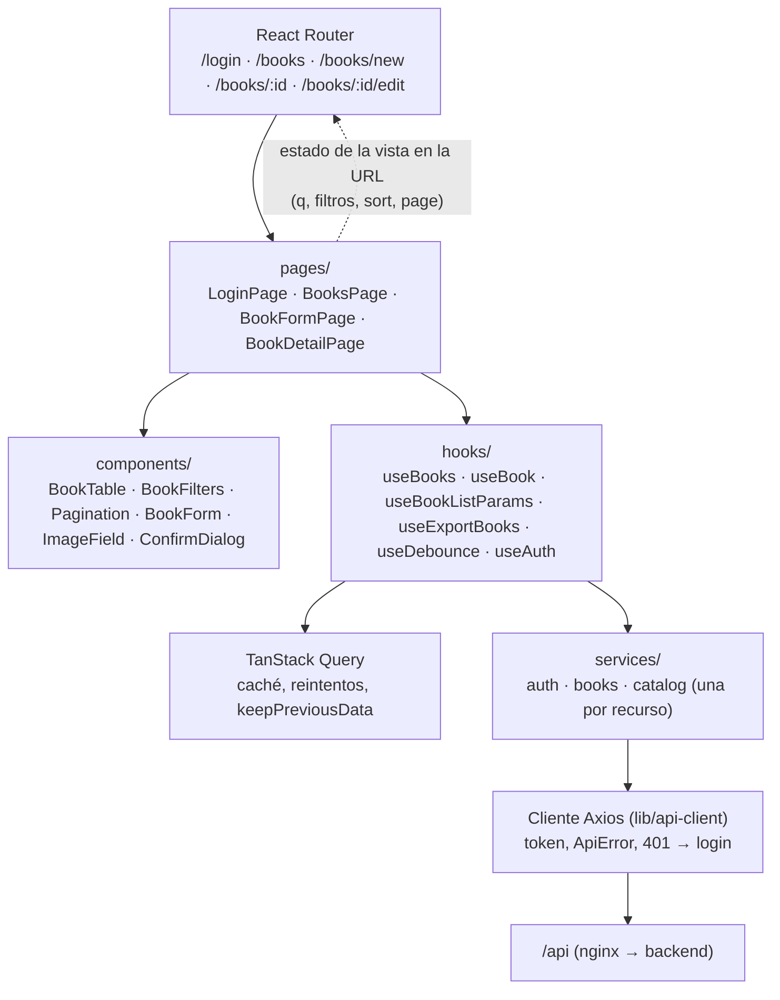

# Arquitectura de CMPC Libros

Diagramas en [Mermaid](https://mermaid.js.org/): GitHub los dibuja directamente. Cada nodo corresponde a código real (módulos de `backend/src/app.module.ts`, rutas de la API y `docker-compose.yml`). Para el modelo de datos, ver [`erd.md`](erd.md) y [`erd.dbml`](erd.dbml); para las decisiones, el [README](../README.md) y cada `design.md` de `.ai/specs/`.

## 1. Contexto y despliegue (Docker Compose)

- El navegador solo habla con nginx (mismo origen): no hace falta CORS en producción y el puerto del backend no se publica hacia fuera.
- nginx añade su `X-Forwarded-For`; el backend confía **solo en un salto** (`trust proxy = 1`), así que la IP que guarda la auditoría y la que usa el límite de intentos no se puede falsificar desde el cliente.
- Cada servicio tiene su `healthcheck` (`pg_isready`, `GET /api/health` y `/healthz`). `backend` espera a que `db` esté sano; `frontend`, a que `backend` lo esté. Al arrancar, el backend aplica las migraciones (`prisma migrate deploy`) y, solo si se pide, el seed.

## 2. Módulos del backend

- Un controlador solo conoce su servicio; ningún controlador usa Prisma. `BooksService` no escribe en `audit_logs`: llama a `AuditService`.
- `PrismaModule` es global; el resto de módulos declaran solo lo que importan de otros módulos de negocio.
- El guard JWT se registra con `APP_GUARD`: **todo está protegido** salvo lo marcado `@Public()` (`/api/health` y `/api/auth/login`). Un test e2e recorre el documento OpenAPI y exige 401 en cada ruta.

## 3. Una escritura: transacción y auditoría

- Mismo patrón para crear (sin bloqueo ni `before`), eliminar (borrado lógico) y cambiar o quitar la portada.
- El bloqueo de fila hace que dos ediciones simultáneas del mismo libro hagan cola: cada `before` es el `after` de la entrada anterior.
- Los inicios de sesión se auditan fuera de una transacción de negocio y **con mejor esfuerzo**: un fallo de la tabla de auditoría no impide entrar.

## 4. Exportación a CSV (flujo)

- La memoria usada depende del tamaño del lote, no del de la tabla (medido: +24 MB con 305.000 libros).
- Los filtros y el orden se construyen con las mismas funciones puras que el listado (`buildBookWhere`, `buildBookOrderBy`), por lo que el CSV y la tabla no pueden divergir.

### Exportación a Excel

- A diferencia del CSV, el archivo se arma completo **antes** de enviar el primer byte (un `.xlsx` es un zip): por eso el tope y cualquier fallo de la base responden con el formato normal de error.
- Una columna por campo, encabezado en negrita y fijo, precio numérico y fechas reales. Los textos van como texto, así que `=…` no se ejecuta como fórmula.

## 5. Frontend

- Los errores del backend (formato único) los traduce un interceptor de Axios a `ApiError`; la UI muestra mensajes por campo en formularios y un aviso global para errores de red o sesión caducada.
- El estado del listado (búsqueda, filtros, orden, página) vive en la URL: recargar, volver atrás y compartir el enlace conservan la vista.
