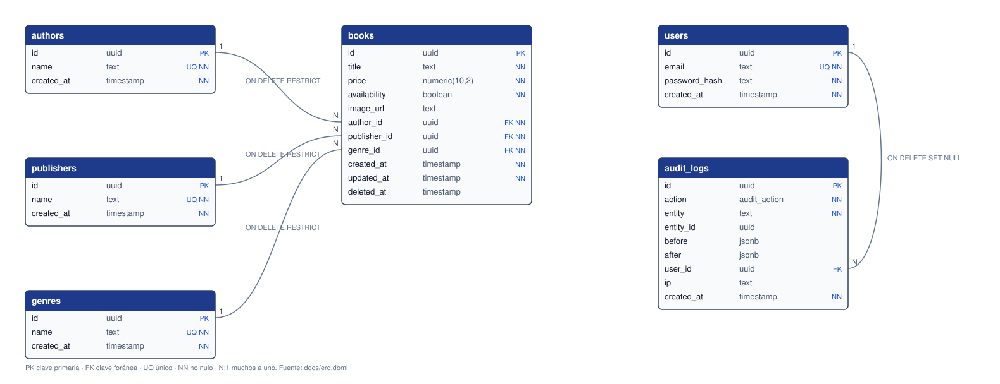
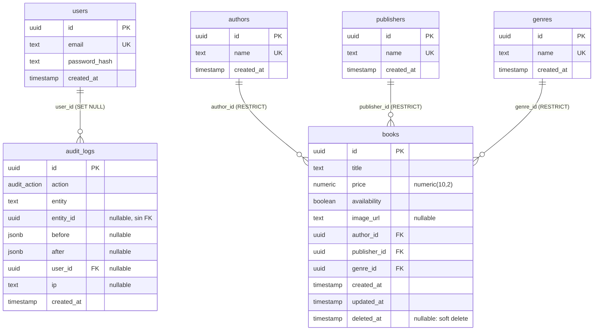

# Modelo relacional

Seis tablas en PostgreSQL 16, normalizadas: los autores, editoriales y géneros son catálogos y cada libro los referencia por clave foránea. Fuente de verdad: [`backend/prisma/schema.prisma`](../backend/prisma/schema.prisma) y las migraciones de [`backend/prisma/migrations/`](../backend/prisma/migrations).

- Imagen exportada: [`erd.svg`](erd.svg) (se regenera con `python docs/tools/dbml-to-svg.py`).
- Para dbdiagram.io: [`erd.dbml`](erd.dbml) → *Import → DBML*.
- Comprobado tabla por tabla, columna por columna, índice por índice y clave foránea por clave foránea contra una base migrada (ver el registro de `docs-delivery`).

## Decisiones del modelo

| Decisión | Motivo |
|---|---|
| Catálogos (`authors`, `publishers`, `genres`) como tablas propias con nombre único | Normalización: sin duplicar texto en cada libro, filtros por clave foránea con índice y un solo lugar donde corregir un nombre |
| Claves foráneas `ON DELETE RESTRICT` desde `books` | No se puede borrar un autor, editorial o género con libros; los libros se eliminan de forma lógica, nunca en cascada |
| `price numeric(10,2)` | Dinero exacto (sin errores de coma flotante); hasta 99.999.999,99 |
| `availability boolean` | El enunciado pide «disponibilidad»; el stock por unidades queda fuera de alcance |
| `deleted_at` solo en `books` | Soft delete (BE-5): los catálogos no se borran y la auditoría no se toca. Una extensión del cliente Prisma añade `deleted_at IS NULL` a las lecturas, de modo que ningún servicio puede olvidarlo |
| `audit_logs.entity_id` sin clave foránea | El historial de un libro eliminado debe conservarse |
| `audit_logs.user_id` con `ON DELETE SET NULL` | El historial sobrevive a la cuenta; también es NULL cuando un intento de login falla con un correo inexistente |
| Identificadores `uuid` generados por la aplicación | No revelan cuántos registros hay ni su orden, y permiten crearlos antes de insertarlos |

## Índices

| Tabla | Índice | Para qué |
|---|---|---|
| `books` | `books_author_id_idx`, `books_publisher_id_idx`, `books_genre_id_idx` | Filtros del listado y comprobaciones de las claves foráneas |
| `books` | `books_availability_idx` | Filtro por disponibilidad |
| `books` | `books_deleted_at_created_at_idx` `(deleted_at, created_at)` | Listado por defecto: activos, más recientes primero |
| `books` | `books_title_trgm_idx` GIN `gin_trgm_ops` | Búsqueda parcial por título (`ILIKE '%…%'`) sin recorrer la tabla. Requiere la extensión `pg_trgm`; **migración SQL manual** porque Prisma no la expresa |
| `books` | `books_active_title_author_publisher_key` único **parcial** `(lower(title), author_id, publisher_id) WHERE deleted_at IS NULL` | No hay dos libros activos iguales (sin distinguir mayúsculas), pero se puede volver a registrar uno eliminado. **Migración SQL manual** |
| `authors`, `publishers`, `genres` | `*_name_key` único | Un nombre, un registro |
| `users` | `users_email_key` único | Un correo, una cuenta |
| `audit_logs` | `(entity, entity_id)`, `user_id`, `created_at` | Historial de un libro o usuario, de un usuario y por fecha |
